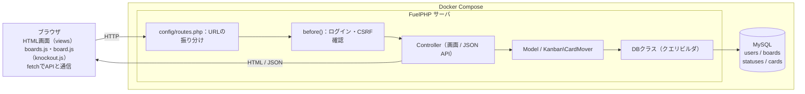
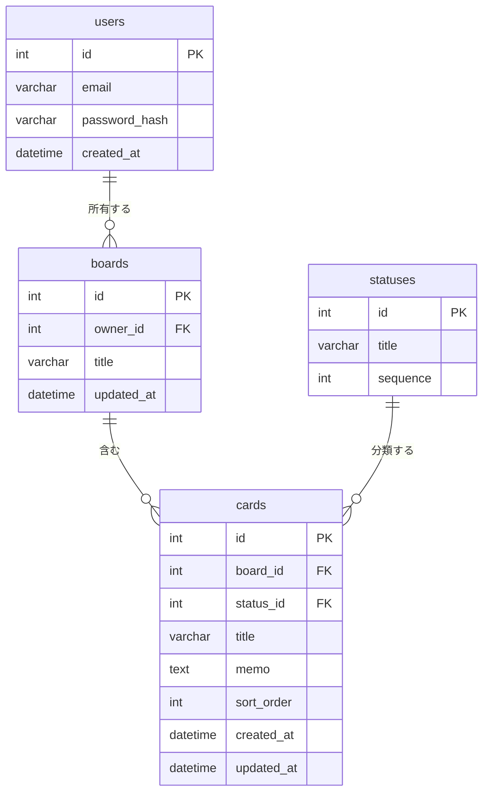
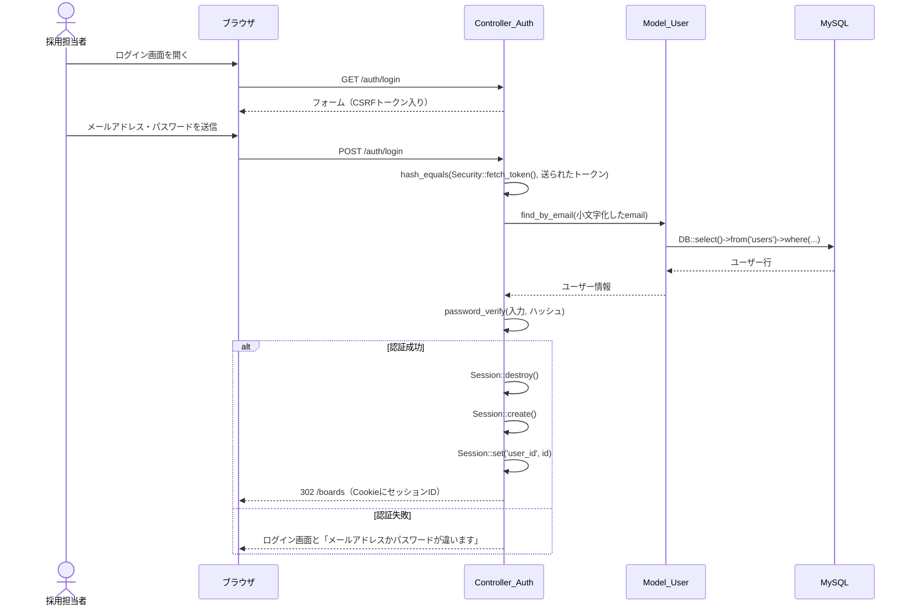
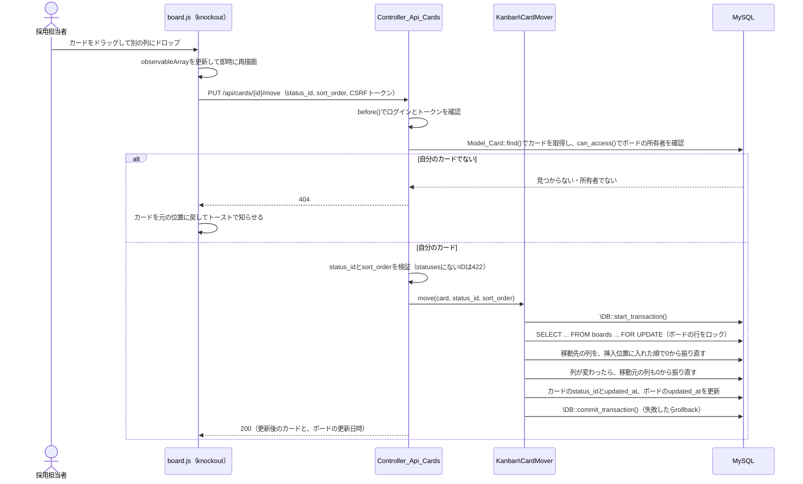

# カンバン型採用管理アプリ 設計書

2026-11-18 時点

## 0. 課題の必須条件

課題条件シートの13項目と、それぞれをこのアプリでどう満たすかの対応。実装後は課題条件シートの「実装内容」欄にこの表の実装方針を転記し、完了欄にチェックを入れる。

| No. | 必須条件（課題条件シートより） | 実装方針 | 主な実装箇所 |
| --- | --- | --- | --- |
| 1 | サーバサイド言語はPHPで、フレームワークのFuelphpを使用すること | サーバ側はFuelPHPのMVCで実装する | fuel/app/ 全体 |
| 2 | beforeメソッドを使う | 基底コントローラを画面用のController_Base（Controller_Templateを継承）とAPI用のController_Api_Base（Controller_Restを継承）の2つ作り、それぞれのbefore()でログイン確認とCSRF確認を行う。確認処理は1か所にまとめて両方から呼ぶ。未ログイン時は画面ならログイン画面へリダイレクト、APIなら401を返す。どちらも例外（HttpRedirectException・HttpJsonException）で処理を止め、exitしない（Response::redirect()は中でexitするので使わない） | controller/base.php、controller/api/base.php |
| 3 | configファイルをカスタマイズする | db.php（接続先）、session.php（セッションの保存先）、config.php（Cookie属性とCSRFトークンの有効期限）、routes.php（URL設計）を変更し、独自のkanban.php（status_idごとの表示色（点・札・列見出しの3種類）をTailwindのクラス名で持つ。選考ステージの名前と順番はDBのstatusesが持ち、configは見た目だけを持つ）を追加する | config/ |
| 4 | sessionやcookieを使う | ログイン状態をSessionにuser_idで保持し、ログイン成功時にSession::destroy()とSession::create()でセッションを作り直す（ADR 0001）。セッションIDはCookieで受け渡し、Cookieの属性はconfig.phpのcookieで設定する（ADR 0003） | controller/auth.php、controller/base.php、config/session.php、config/config.php、classes/cookie.php |
| 5 | ネームスペースを使う（実装していなくても、目的と使い方を口頭で説明できればOK） | カード移動の並び替え処理をKanban名前空間のクラス Kanban\CardMover に切り出す | classes/kanban/cardmover.php |
| 6 | \（バックスラッシュ）を使ったグローバルな名前空間へのアクセスについて理解している | Kanban名前空間内からは `\DB` や `\Session` のように先頭の`\`を付けてコアクラスを呼ぶ | classes/kanban/cardmover.php |
| 7 | データベースとのやり取りはDBクラスを使うこと | 全クエリをDB::select / insert / update / delete のクエリビルダで書く。ORMは使わない（ADR 0006）。カードの作成と移動でボードの行をロックするFOR UPDATEだけは、クエリビルダに方法がないためDB::query()で書き（Model_Board::lock()の1か所）、値はparam()でバインドする | model/、kanban/cardmover.php |
| 8 | 1:n関係のテーブル構造があること（正規化について説明できること） | users 1:n boards 1:n cards、statuses 1:n cards。列名はstatusesテーブルに分離する（4章） | migrations/ |
| 9 | CRUDの機能が網羅されている | ボードとカードで作成・参照・更新・削除をすべて実装する（5章） | controller/api/boards.php、controller/api/cards.php |
| 10 | フロントエンドのライブラリにknockout.jsが使用されている | ボード一覧画面とカンバン画面の状態をobservableArrayで持ち、バインディングで描画する | public/assets/js/boards.js、public/assets/js/board.js、public/assets/js/ui.js |
| 11 | uxを考慮して一部動的なuiが実装されている（非同期処理） | D&D、ボードとカードの追加・編集・削除をfetchでAPIに送り、ページ遷移せずに画面へ反映する。保存に失敗したら元に戻す。カードの追加・編集はモーダル、削除の確認は独自のダイアログで行い、ページ遷移しない | public/assets/js/boards.js、public/assets/js/board.js、controller/api/ |
| 12 | GitHubでコードの管理を行う | mainへの直接pushを禁止し、作業ブランチからプルリクエストで取り込む。CIは作らず、テストは手元で `php oil test` を実行する（7章） | GitHubのリポジトリ |
| 13 | セキュリティ資料を読み必要な実装を行う | 7章の対策を資料の項目と照合済み。実装後にチェックシートで確認する | 7章を参照 |

### 口頭で説明する項目

No.5、6、8は「説明できること」が条件に含まれるため、レビューで話す内容を決めておく。

- **ネームスペース（No.5）**：同じ名前のクラスがぶつからないように、役割ごとにまとめる仕組み。FuelPHPでは classes/kanban/cardmover.php に `namespace Kanban;` と書くと、`Kanban\CardMover` として自動で読み込まれる。
- **グローバル名前空間へのアクセス（No.6）**：Kanban名前空間の中で `DB` とだけ書くと、PHPは `Kanban\DB` を探してしまう。先頭に`\`を付けた `\DB` は、名前空間の外（グローバル）にあるFuelPHPのDBクラスを指す。
- **正規化（No.8）**：同じ情報を複数の場所に持たせないように、テーブルを分けること。列名をcardsに文字列で持たせず statuses に分離しているので、列名を変えてもstatusesの1行を直すだけで済み、表記揺れも起きない。

## 1. 要件

採用担当者が応募者の選考状況をカンバン形式で管理するアプリを、11/21〜12/14の約3.5週間、開発工数60hで開発する。課題条件のCRUDを満たすため、シートの機能要件にボードとカードの編集・削除を追加している。また、不採用・辞退になった応募の記録を残すため、選考ステージに「不採用・辞退」列を追加している。

業務上の用語と画面・コード上の呼び方の対応は次のとおり（定義はリポジトリ直下の GLOSSARY.md）。

| 業務上の用語 | 画面上の呼び方 | テーブル |
| --- | --- | --- |
| 採用担当者 | ユーザー | users |
| ポジション（1つの募集枠） | ボード | boards |
| 応募（1人の応募者の1ポジションへの応募） | カード | cards |
| 選考ステージ | 列 | statuses |

同じ人が2つのポジションに応募した場合は、互いに関係のない2枚のカードになる。内定辞退も「不採用・辞退」列に移す。

### 機能要件

| 機能 | 内容 | 優先度 |
| --- | --- | --- |
| ユーザー登録・ログイン | 登録、ログイン、ログアウト。未ログインでは全画面を表示しない。パスワードは8文字以上、半角72文字以内（全角は24文字以内）。bcryptは72バイトより後ろを無視するため、文字数ではなくバイト数で上限を判定する | 必須 |
| ボード管理 | 作成・一覧・名前変更・削除（物理削除。実行前に「このボードのカードN枚も一緒に削除され、元に戻せません」と件数入りの確認ダイアログを出す）。ボード一覧には、ボードごとの選考ステージ別の人数・積み上げバー・更新日時を出す。名前変更と削除は、ボード一覧とカンバン画面の両方からできる。ボード一覧画面もページ遷移なしで操作する | 必須 |
| カード管理 | 作成・編集・削除（物理削除。実行前に確認ダイアログを出す）。作成と編集はモーダルで行い、削除は編集モーダルの中から行う。各列の「カードを追加」からその列に、画面上部の「カードを追加」から最初の選考ステージ（書類選考）に作成でき、列の一番下に追加される。カードには応募者名・メモ・更新日時を出す | 必須 |
| 列 | 書類選考 / 一次面接 / 最終面接 / 内定 / 不採用・辞退 の5列で固定。選考が終わった応募は削除せず「不採用・辞退」列に移して記録を残す | 必須 |
| ドラッグ&ドロップ | 列をまたぐ移動と列内の並び替え。移動はページ遷移なしで保存 | 必須 |
| 他者ボードの操作不可 | 自分のボード以外は閲覧・編集・削除できない。URLやAPIを直接指定しても404を返す | 必須 |

### 非機能要件

- セキュリティ：SQLインジェクション、XSS、CSRF、セッション固定化への対策を入れる（詳細は7章）
- 操作感：D&Dの結果は画面に即時反映し、保存に失敗したらカードを元の位置に戻して、画面下のトーストで知らせる。入力エラーは、入力欄の近く（モーダルの中など）に出す
- 保守性：コードはGitHubで管理し、プルリクエスト単位でレビューしてから取り込む

### スケジュール

1. 実装：11/21（土）〜 12/3（木）
2. テスト：12/5（土）〜 12/6（日）
3. レビュー：12/7（月）〜 12/9（水）
4. 修正：12/9（水）〜 12/11（金）
5. バッファ：12/12（土）〜 12/14（月）

12/4（金）は空いているため、実装が遅れた場合の予備日に使える。

## 2. 技術選定と理由

課題条件で決まっているPHP / FuelPHP / knockout.js / GitHubを軸に、残りは追加ライブラリを最小にする方針で選んだ。開発環境（docker/Dockerfile）はPHP 7.3で、すでにサポートが終了している。課題の想定環境に合わせており、7.3のまま使うことをメンターに確認済み。

| 領域 | 採用技術 | 理由 |
| --- | --- | --- |
| サーバサイド | PHP 7.3 + FuelPHP 1.8系 | 課題条件。before()、config、Session、DBクラスがフレームワーク標準で揃う |
| DBアクセス | FuelPHPのDBクラス（クエリビルダ） | 課題条件。値はバインドされるためSQLインジェクションを防ぎやすい。ORM（Orm\Model）は使わない。このアプリのクエリは件数の集計（JOIN・GROUP BY）とカードの作成・移動のロック（FOR UPDATE）が中心で、ORMでも結局クエリビルダやSQLを混ぜることになり、ORMの便利さ（リレーション、オブジェクトの保存）を使う場面が少ないため。権限の確認も、ユーザーIDを受け取るModelのメソッドとcan_access()に集めやすい（ADR 0006） |
| データベース | MySQL 8.0（InnoDB、文字コードutf8mb4） | FuelPHPのDBクラスが標準で対応し、外部キー制約とトランザクションが使える。utf8では絵文字や一部の漢字を保存できないため、db.phpのcharsetをutf8mb4に変える |
| 認証 | 自前実装（Session + password_hash） | FuelPHPのAuthパッケージ（SimpleAuth）は、このアプリの要件を満たすには中心の処理を上書きする必要があり、便利さが残らない。ログイン時に中でSession::rotate()を呼ぶためセッション固定化を防げず（ADR 0001）、パスワードは全ユーザー共通のソルトで保存してpassword_verifyを使えない。usersテーブルにも使わない列が増える。Authの利点（remember me、権限のグループなど）は要件にない。自前実装なら課題条件No.4も自分で書いたSession::set()で説明できる（ADR 0005） |
| フロントエンド | knockout.js | 課題条件。カードの配列をobservableArrayで持てば、移動後の再描画を自動で行える |
| スタイリング | Tailwind CSS（スタンドアロンCLIでビルド） | knockoutのcssバインディングでクラスを付け外しするだけで、ドラッグ中などの見た目を切り替えられる。Node.jsなしでビルドでき、使ったクラスだけを出力するのでCSSが小さく済む。クラス名はJSで組み立てず、省略せずに書く。ビルドの方法はADR 0004。色はデザイン案の値をtailwind/input.cssの@themeに名前付きで登録し、画面ではその名前で使う（同じ値を画面に直接書くと、まとめて変えられなくなるため）。フォントは外部から読まず端末のものを使う |
| モーダル・確認ダイアログ | HTML標準の`<dialog>`とshowModal() | Escで閉じる、後ろの画面を操作させない、後ろを暗くする、をブラウザに任せられる。削除の確認にwindow.confirmを使わないのは、見た目を画面に揃えるためと、ブラウザの自動操作による確認が本物のダイアログで止まるため |
| ドラッグ&ドロップ | HTML5 Drag and Drop API | 追加ライブラリなしでknockoutのeventバインディングから扱える |
| 非同期通信 | fetch API（JSON） | ブラウザ標準で、jQueryを入れずに済む |
| 開発環境 | Docker Compose（PHP / MySQL） | レビュアーが同じ環境を再現できる |
| テスト | PHPUnit 5.7（oil test） | FuelPHPに組み込みのテストランナーで動く。FuelPHP 1.8のTestCaseはPHPUnit_Framework_TestCaseを継承しており、そのクラスがない6系以降では動かないため5.7にする。appコンテナのイメージにpharで入れる |
| ソース管理 | GitHub | 課題条件。CI（GitHub Actions）は課題条件に含まれず、1人開発で手元のテストが動くため作らない（7章） |

## 3. 構成図



ブラウザからのリクエストはroutes.phpで振り分けられ、before()でログインとCSRFを確認してからControllerに届く。DBへのアクセスはすべてDBクラスを経由し、PHPとMySQLはDocker Composeで一緒に起動する。

## 4. データ構造

テーブルはusers・boards・statuses・cardsの4つで、users 1:n boards 1:n cards の1:n関係を持つ。列名をcardsに文字列で持たせずstatusesに分離するのが正規化のポイントで、列名を変えても1行の更新で済む。



### users

| カラム | データ型 | null | デフォルト | 備考 |
| --- | --- | --- | --- | --- |
| id | INT UNSIGNED | NO | AUTO_INCREMENT | 主キー |
| email | VARCHAR(255) | NO | | ログインID。小文字に揃えて保存する。UNIQUE |
| password_hash | VARCHAR(255) | NO | | password_hashで生成したハッシュ |
| created_at | DATETIME | NO | | 作成日時 |

### boards

| カラム | データ型 | null | デフォルト | 備考 |
| --- | --- | --- | --- | --- |
| id | INT UNSIGNED | NO | AUTO_INCREMENT | 主キー |
| owner_id | INT UNSIGNED | NO | | users.idへの外部キー。所有者。ON DELETE CASCADE |
| title | VARCHAR(100) | NO | | ボード名 |
| updated_at | DATETIME | NO | | 作成・更新日時。ボード名の変更時とカード操作時に更新し、ボード一覧はこの新しい順に並べる。ボード一覧とカンバン画面に「月/日 時:分」で表示する |

### statuses

| カラム | データ型 | null | デフォルト | 備考 |
| --- | --- | --- | --- | --- |
| id | TINYINT UNSIGNED | NO | | 主キー。1〜5を初期データで投入 |
| title | VARCHAR(20) | NO | | 書類選考 / 一次面接 / 最終面接 / 内定 / 不採用・辞退 |
| sequence | TINYINT UNSIGNED | NO | | 列の左からの表示順 |

statusesは選考ステージのマスタで、画面から追加・削除はしない。cardsから参照されている行は外部キー制約（ON DELETE RESTRICT）により削除できない。

### cards

| カラム | データ型 | null | デフォルト | 備考 |
| --- | --- | --- | --- | --- |
| id | INT UNSIGNED | NO | AUTO_INCREMENT | 主キー |
| board_id | INT UNSIGNED | NO | | boards.idへの外部キー。ON DELETE CASCADEでボード削除時に一緒に消える |
| status_id | TINYINT UNSIGNED | NO | 1 | statuses.idへの外部キー。所属する選考ステージ（列）。ON DELETE RESTRICT。statusesに存在しないIDはDBが拒否する |
| title | VARCHAR(100) | NO | | 応募者名 |
| memo | TEXT | YES | NULL | メモ |
| sort_order | INT UNSIGNED | NO | 0 | 列内の並び順。0が一番上で、列ごとに0からの連番。新規作成時は列の末尾（その列のMAX+1）に入れる |
| created_at | DATETIME | NO | | 作成日時。画面には出さない（カードには updated_at を出す） |
| updated_at | DATETIME | NO | | 作成・更新日時。最後に選考ステージや内容が変わった日時。他のカードのsort_order更新で変わらないよう、自動更新（ON UPDATE CURRENT_TIMESTAMP）は使わず、コードで動かしたカードにだけ値を入れる。カードと編集モーダルに「月/日 時:分」で表示する |

cardsには (board_id, status_id, sort_order) の複合インデックスを張り、列ごとの並び順取得を速くする。board_idの外部キーはこの複合インデックスの先頭列で兼ねる。status_idは先頭列ではないため、外部キー用のインデックスをMySQLが自動で作る。

created_at・updated_at は、PHPの date() ではなく、書き込むSQLの中で MySQL の NOW() で決める。カードの作成・移動はボードのロックを待つことがあり、待つ前にPHPで決めると、先に済んだ操作より古い日時が入るため。MySQLのタイムゾーンはサーバーの設定に任せず、接続ごとに db.php の time_zone（'+09:00'）で日本時間にする（FuelPHP 1.8 のDB設定にはこの項目がないので、MySQLiの接続クラスを差し替えて接続直後に SET time_zone を実行する）。

## 5. エンドポイント一覧

画面はHTMLを返すController_Baseの子クラス、ボードとカードの変更はJSONを返すController_Api_Base（Controller_Restを継承）の子クラスで分ける。画面用コントローラは表示だけを行い、データの変更はすべてAPIで行う。URLとアクションの対応はconfig/routes.phpで定義し、ログイン系以外はすべてbefore()でログイン確認を通す。

### 画面

| メソッド | パス | コントローラ::アクション | 内容 | ログイン |
| --- | --- | --- | --- | --- |
| GET | /auth/register | Controller_Auth::get_register | 登録フォーム | 不要 |
| POST | /auth/register | Controller_Auth::post_register | email・passwordで登録してボード一覧へ | 不要 |
| GET | /auth/login | Controller_Auth::get_login | ログインフォーム | 不要 |
| POST | /auth/login | Controller_Auth::post_login | email・passwordで認証してボード一覧へ | 不要 |
| POST | /auth/logout | Controller_Auth::post_logout | セッション破棄してログインへ | 必要 |
| GET | /boards | Controller_Boards::get_index | ボード一覧 | 必要 |
| GET | /boards/{id} | Controller_Boards::get_view | カンバン画面 | 必要（所有者のみ） |
| GET | （存在しないURL） | Controller_Error::action_404（routes.phpの`_404_`） | 404画面。他人のボードと存在しないボードもここに来る | 不要 |

### 画面の作り

見た目はデザイン案（ログイン・新規登録・ボード一覧・カンバン・カード作成/編集・削除確認・404）に合わせる。デザイン案は選考ステージが4列だが、不採用・辞退を残して5列にする（1章）。

| 画面・部品 | 内容 |
| --- | --- |
| ヘッダー | ロゴ（ボード一覧へのリンク）、ログイン中のメールアドレス、ログアウト。ログイン前の画面（ログイン・新規登録）はヘッダーを出さず、ロゴとフォームを中央に置く |
| ボード一覧 | 上に新しいボードの入力欄。ボードはカード型で並べ、ボード名・人数・更新日時、名前変更（鉛筆）と削除（ゴミ箱）、選考ステージ別の人数と積み上げバーを出す |
| カンバン | パンくず（ボード一覧 / ボード名）、ボード名と名前変更、「N名 ・ 最終更新」、ボードを削除、カードを追加。列は選考ステージごとに色の点と件数を出し、空の列には「ここにカードをドロップ」を出す。列の最小幅は200pxで、横幅1280px前後のノートPCでも5列が1画面に収まる。それより狭い画面では列を縮めず横スクロールにする |
| カードのモーダル | 応募者名（文字数を「n / 100」で表示）、選考ステージ（作成時は追加する列、編集時は今の列。変更はD&Dで行う）、メモ、最終更新（編集時）。編集時は左下に「カードを削除」 |
| 削除の確認ダイアログ | ボードとカードで共通。キャンセルにフォーカスを置き、Escでも閉じる。カードの削除は編集モーダルの上に重ねて開き、キャンセルするとモーダルに戻る |
| トースト | 画面下に出す。移動・削除・読み込みの失敗を知らせ、「閉じる」で消す |
| 404・403 | アプリの見た目で、ボード一覧へ戻るボタンを出す。403はCSRFトークンの不一致などで出る |

### API（JSON）

| メソッド | パス | 内容 | 主なリクエスト | 成功時 |
| --- | --- | --- | --- | --- |
| GET | /api/boards | 自分のボード一覧 | | 200 |
| POST | /api/boards | ボード作成 | title | 201 |
| PUT | /api/boards/{id} | ボード名変更 | title | 200 |
| DELETE | /api/boards/{id} | ボード削除（物理削除。cardsもCASCADEで削除） | | 204 |
| GET | /api/boards/{id}/cards | 列ごとのカード一覧 | | 200 |
| POST | /api/boards/{id}/cards | カード作成（指定した列の末尾に追加） | title, memo, status_id | 201 |
| PUT | /api/cards/{id} | カード編集 | title, memo | 200 |
| PUT | /api/cards/{id}/move | カード移動 | status_id, sort_order（移動先の列で上から何番目に入れるか。0始まり） | 200 |
| DELETE | /api/cards/{id} | カード削除（物理削除） | | 200 |

カード移動の sort_order は「移動先の列での挿入位置」で、範囲外の値（別タブで枚数がずれた場合など）は末尾に丸める。移動のたびに Kanban\CardMover が移動元と移動先の列を0からの連番に振り直すため、連番を保つ責任はサーバ側だけが持つ。

GET /api/boards は、ボードごとに id・title・updated_at・card_count と、選考ステージ別の件数 status_counts（`[{"status_id": 1, "count": 3}, ...]`）を返す。件数が0のステージは含めず、画面側で0として扱う。status_counts を `{"1": 3}` のようなオブジェクトにしないのは、PHPの空配列がJSONではオブジェクトでなく配列になり、型が揃わなくなるため。ボードとカードを作成・変更するAPIは、画面に更新日時を出すため updated_at も返す。

カードの作成・編集・移動・削除は、ボードの更新日時も `{"board": {"updated_at": "..."}}` で返す（作成・編集・移動はカードの `card` と並べて返す）。カードを操作するとボードの updated_at も変わる（4章）ので、カンバン画面の「最終更新」をその値で進めるため。ブラウザの時計で進めると、利用者の端末の時計やタイムゾーンがサーバーとずれたとき、再読み込みした後の表示と食い違う。

> 2026-11-20 変更：カード削除の成功時を 204（本文なし）から 200（ボードの updated_at を返す）にし、カードの作成・編集・移動もボードの updated_at を返すようにした。それまで画面は、保存に成功するとブラウザの時計で「最終更新」を進めていた（コードレビューでの指摘）。ボード削除は画面がすぐボード一覧へ移るので、204 のまま。

全APIで共通のエラーは、未ログインが401、他人のボードやカードが404、入力エラーが422、CSRFトークン不一致が403とする。他人のリソースに403ではなく404を返すのは、そのIDが存在すること自体を知らせないため。

## 6. ログインとカード移動のシーケンス

### ログイン

ログイン成功時にセッションを破棄して作り直してからuser_idを保存し、以降の画面はbefore()がそのuser_idを見て通すかどうかを決める。



### カード移動

画面を先に動かしてからAPIで保存し、失敗したら元に戻す。サーバ側は、操作してよいカードかを Model_Board::can_access() で確かめてから、並び替えを1つのトランザクションで行う。同じボードで同時に移動されても連番が崩れないよう、トランザクションの最初にボードの行を FOR UPDATE でロックする。



## 7. セキュリティ、テスト、起動手順、ディレクトリ構成

### セキュリティ

課題のセキュリティ資料の項目と照合済みで、下表の対策で不足はない。

| 脅威 | 対策 | 実装箇所 |
| --- | --- | --- |
| SQLインジェクション | DBクラスのクエリビルダで値をバインドし、SQLを文字列連結しない | 全Model |
| XSS | ViewのエスケープとknockoutのtextバインディングでHTMLとして出力しない。htmlバインディングは使わない | views、boards.js、board.js |
| CSRF | フォームはForm::csrf()で隠し項目にトークンを埋め込む。APIは画面の`<meta name="csrf-token">`にSecurity::fetch_token()の値を埋め込み、ui.js の callApi() がfetchのたびに`X-CSRF-Token`ヘッダで送る（board.js・boards.js はこれを使う）。どちらもbefore()からGuard::check()を呼び、`hash_equals(Security::fetch_token(), 送られたトークン)`で比べ、不一致なら403。Security::check_token()は確認のたびにトークンを作り直し、同じ画面からの2回目のAPI呼び出しが403になるため使わない。config.phpのcsrf_expirationを1日にして、トークンを作り直さないようにする（ADR 0002） | Guard、Controller_Base::before()、Controller_Api_Base::before()、views/template.php、config/config.php、public/assets/js/ui.js |
| セッション固定化 | ログイン成功時にSession::destroy()→Session::create()でセッションを作り直してからuser_idを保存する。Session::rotate()はfileドライバで古いIDに新しいIDへの転送先を残すため、ログイン前に仕込まれたIDでもログイン後のセッションに入れてしまう（ADR 0001） | Controller_Auth::post_login |
| パスワード漏えい | password_hashで保存し、password_verifyで照合する。平文はログにも残さない | Model_User |
| アカウント列挙 | ログイン失敗時は未登録かパスワード違いかを区別せず「メールアドレスかパスワードが違います」と返す。登録画面の「すでに登録されています」からは登録済みのメールアドレスがわかるが、防ぐにはメールでの本人確認が要るため、課題の範囲外として対応しない。同じ理由で、ログインの応答時間の差（未登録のときは照合しないので速い）も直さない（ADR 0007） | Controller_Auth::post_login |
| 他者リソースへのアクセス | 判定をModel_Board::can_access()にまとめ、すべての取得・更新でboards.owner_idとログイン中のuser_idを条件に入れる | 全Model |
| Cookieの盗用 | config.phpのcookieでHttpOnlyとSameSite=Laxを有効にし、HTTPS環境ではSecureも付ける。FuelPHP 1.8のCookieクラスはSameSiteを渡せないため、classes/cookie.phpでCookie::set()を上書きし、bootstrap.phpでコアのCookieと差し替える。session.phpはfileドライバにして、CookieにはセッションIDだけを入れる（ADR 0003） | config/config.php、classes/cookie.php、bootstrap.php、config/session.php |
| クリックジャッキング | 別サイトがこのアプリの画面を透明なiframeで重ね、ボードの削除などを押させる攻撃。ログイン中の本人が押すのでCSRFトークンでは防げないため、`Content-Security-Policy: frame-ancestors 'none'`でiframeに表示させない。frame-ancestorsに対応していない古いブラウザのために`X-Frame-Options: DENY`も付ける。あわせて`X-Content-Type-Options: nosniff`で、ブラウザが中身から種類を推測してJSとして実行するのを止める。PHPのafter()ではなく.htaccessで付けるのは、例外で返す403・404や静的ファイルにも付けるため。CSPのscript-srcは、knockoutがバインディングの解釈にnew Functionを使い、'unsafe-eval'を許すことになり守りにならないため、付けていない | public/.htaccess |
| 不正な入力 | Validationクラスで必須・文字数・メール形式（valid_email）を検証する。Validationの既定のメッセージは英語なので、config.phpのlanguageをjaにし、lang/ja/validation.phpに日本語のメッセージを置く。画面ごとに文を変えるもの（「画面を再読み込みしてください」など）だけset_message()で書く。パスワードの上限はmax_length（文字数で数える）ではなく、strlen()で72バイト以内かを確かめる独自のルールで判定する。status_idは数値を直書きせず、statusesテーブルに存在するIDかを確認し、なければ422を返す（DBの外部キー制約は最後の防衛線）。文字列や数値を期待する項目に配列などが送られると、型の変換でNoticeになり500になるので、Validationの前に入力エラーにする。フォームは各項目の最初のルールで文字列かを確かめ、APIはController_Api_Baseで、本文がJSONのオブジェクトであることと、値が文字列・数値・nullのどれかであることを確かめて422を返す。本文がオブジェクトでないとInput::json()の中でWarningになるため、classes/input.phpで本文をそのまま返すInput::raw()を足し、bootstrap.phpでコアのInputと差し替えて、Input::json()の前に確かめる | 各Controller、controller/api/base.php、classes/input.php、bootstrap.php |
| 情報漏えい | 本番相当の環境ではエラー詳細を画面に出さず、DBの接続情報は環境変数（DB_HOST・DB_NAME・DB_USER・DB_PASSWORD）から読む。初めて暗号化（セッションなど）を使うとFuelPHPが鍵の入った config/crypt.php を自動で作るため、.gitignoreに入れてコミットしない | config/production/db.php、config/staging/db.php、.gitignore |

### テスト

12/5〜12/6のテスト期間では、自動テストで並び替えと権限のロジックを、手動テストで画面操作を確認する。DBを使うテストは setUp() で DB::start_transaction()、tearDown() で DB::rollback_transaction() を呼び、テスト用DBにデータを残さない。手動テストの項目はスプレッドシートのチェックシートに転記する。

| 種類 | 対象 | 確認する内容 |
| --- | --- | --- |
| 単体テスト（PHPUnit） | Kanban\CardMover | 列内・列間の移動後にsort_orderが0から連番になる |
| 単体テスト（PHPUnit） | Model_Card | 他人のカードIDを指定すると取得・更新できない |
| 単体テスト（PHPUnit） | Model_User | 正しいパスワードだけ認証が通る |
| 単体テスト（PHPUnit） | Model_Board | 選考ステージ別の件数に、他人のボードのカードが入らない |
| 単体テスト（PHPUnit） | Controller_Base・Controller_Auth | 未ログインで画面を開くとログイン画面へ、ログイン中にログイン画面を開くとボード一覧へ転送する |
| 手動テスト | ログイン | 未ログインで/boardsを開くとログイン画面に戻る |
| 手動テスト | 権限 | 別ユーザーのボードIDをURLに入れると404になる |
| 手動テスト | D&D | 移動後に再読み込みしても位置が保たれる |
| 手動テスト | D&D | 通信を切って移動するとカードが元の位置に戻る |
| 手動テスト | XSS | カード名に`<script>`を入れても文字列として表示される |

### 起動手順（CI/CDは作らない）

CI（GitHub Actions）は作らない。課題条件No.12は「GitHubでコードの管理を行う」だけでCIを求めておらず、1人開発で `php oil test` が手元で動くため、MySQLのサービスコンテナやPHP 7.3の用意に手間をかけるほどの利点がない。プルリクエストを作る前に、手元で `php oil test` を実行する。

レビュアーは提出したリポジトリをクローンし、自分のPCのDockerで起動する前提のため、CD（デプロイ）も作らない。代わりにREADMEに、docker/ での起動手順とマイグレーションの実行方法を書く。ホストの3306番がほかのMySQLで使われている環境向けに、dbのポート公開を外す上書きファイル docker/compose.noport.yml を用意し、`-f` で足して起動できるようにする。

### ディレクトリ構成

```
kanban-todo/
├── docker/
│   ├── docker-compose.yml         # PHP 7.3 + MySQL 8.0
│   ├── compose.noport.yml         # dbのポート公開を外す上書き（3306番が使用中の環境向け）
│   ├── Dockerfile                 # PHPコンテナ（PHPUnit 5.7 を含む）
│   └── db/                        # MySQLコンテナの設定
├── docs/
│   ├── design.md                  # 設計書（この文書）
│   └── adr/                       # 判断の理由（ADR）
├── tailwind/input.css             # Tailwindの入力。探索対象にviews・js・kanban.phpを指定
├── fuel/
│   └── app/
│       ├── bootstrap.php          # Cookie・Input・MySQLi接続クラスの差し替え
│       ├── classes/
│       │   ├── cookie.php         # Cookie::set()の上書き（SameSite）
│       │   ├── input.php          # Input::raw()の追加（APIでJSONの本文を確かめる）
│       │   ├── guard.php          # ログイン・CSRFトークンの確認、ログイン中のユーザー
│       │   ├── httpjsonexception.php # APIのエラーをJSONで返す例外（before()から処理を止める）
│       │   ├── httpredirectexception.php # 画面を別のページへ転送する例外（before()から処理を止める）
│       │   ├── database/mysqli/connection.php # 接続直後に SET time_zone（MySQLを日本時間にする）
│       │   ├── controller/
│       │   │   ├── base.php       # 画面用の基底。before()でログイン・CSRF確認
│       │   │   ├── auth.php       # 登録・ログイン・ログアウト
│       │   │   ├── boards.php     # ボード一覧・カンバン画面
│       │   │   ├── error.php      # 404画面（routes.phpの_404_）
│       │   │   └── api/
│       │   │       ├── base.php   # API用の基底（Controller_Rest継承）。before()でログイン・CSRF確認
│       │   │       ├── boards.php # ボードAPI
│       │   │       └── cards.php  # カードAPI
│       │   ├── model/
│       │   │   ├── user.php
│       │   │   ├── board.php
│       │   │   ├── card.php
│       │   │   └── status.php     # 選考ステージ（読み取りだけ）
│       │   └── kanban/
│       │       └── cardmover.php  # namespace Kanban。並び替え処理
│       ├── config/
│       │   ├── config.php         # Cookie属性・CSRFトークンの有効期限・言語（ja）
│       │   ├── db.php             # 文字コード（utf8mb4）・タイムゾーン（+09:00）。接続先は環境ごとのフォルダ
│       │   ├── development/db.php # Docker の db コンテナ
│       │   ├── production/db.php  # 環境変数から読む（staging/ も同じ）
│       │   ├── session.php
│       │   ├── routes.php
│       │   └── kanban.php         # 独自config
│       ├── lang/ja/validation.php # Validationの日本語メッセージ
│       ├── migrations/            # テーブル作成と statuses の初期データ
│       ├── tests/                 # PHPUnit
│       └── views/
│           ├── template.php       # 共通のレイアウト
│           ├── _header.php        # ヘッダー（ロゴ・メールアドレス・ログアウト）
│           ├── _logo.php          # ロゴのSVG（ヘッダーとログイン前の画面で共通）
│           ├── _confirm_dialog.php # 削除の確認ダイアログ
│           ├── _toast.php         # 画面下の通知
│           ├── 403.php            # HttpNoAccessException を投げると使われる
│           ├── 404.php
│           ├── auth/
│           └── boards/
├── public/
│   ├── .htaccess                  # index.php への書き換え、セキュリティヘッダー（X-Frame-Options・nosniff）
│   ├── index.php
│   └── assets/
│       ├── js/ui.js               # APIの呼び出しと保存・ダイアログの開閉・確認ダイアログ・トースト・日時の表示（2画面で共通）
│       ├── js/boards.js           # ボード一覧のViewModel
│       ├── js/board.js            # カンバン画面のViewModel
│       └── css/app.css        # Tailwindのビルド結果
└── README.md                      # 起動手順（docker/での起動・マイグレーション）・設計の要約
```
