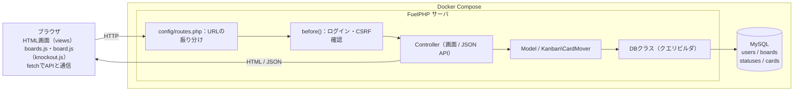
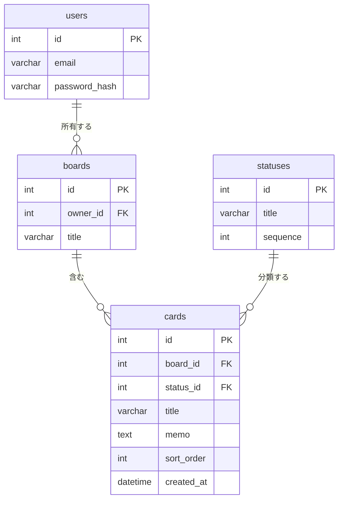
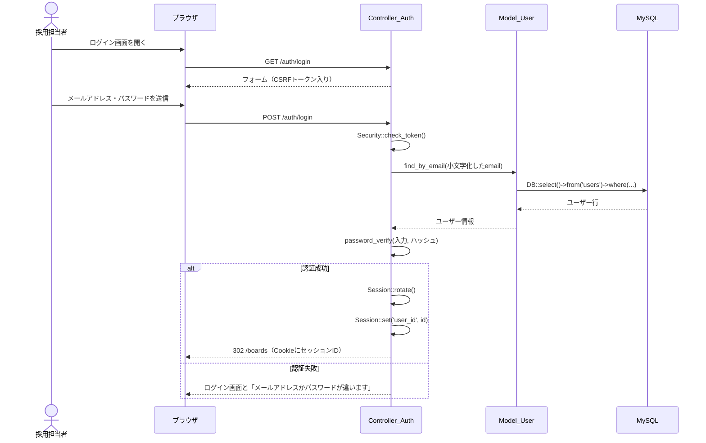
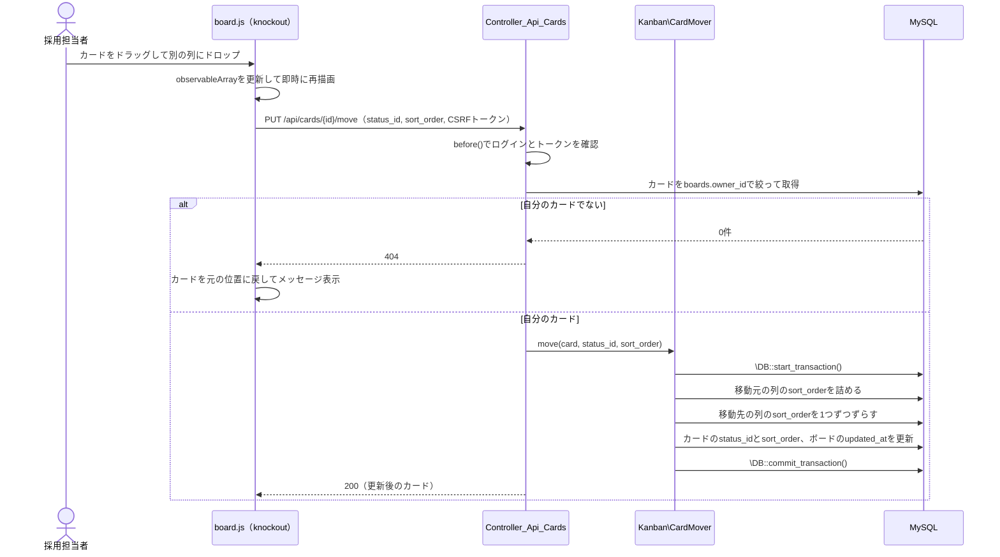

# カンバン型採用管理アプリ 設計書

2026-11-14 時点

## 0. 課題の必須条件

課題条件シートの13項目と、それぞれをこのアプリでどう満たすかの対応。実装後は課題条件シートの「実装内容」欄にこの表の実装方針を転記し、完了欄にチェックを入れる。

| No. | 必須条件（課題条件シートより） | 実装方針 | 主な実装箇所 |
| --- | --- | --- | --- |
| 1 | サーバサイド言語はPHPで、フレームワークのFuelphpを使用すること | サーバ側はFuelPHPのMVCで実装する | fuel/app/ 全体 |
| 2 | beforeメソッドを使う | 基底コントローラを画面用のController_Base（Controller_Templateを継承）とAPI用のController_Api_Base（Controller_Restを継承）の2つ作り、それぞれのbefore()でログイン確認とCSRF確認を行う。確認処理は1か所にまとめて両方から呼ぶ。未ログイン時は画面ならログイン画面へリダイレクト、APIなら401を返す | controller/base.php、controller/api/base.php |
| 3 | configファイルをカスタマイズする | db.php（接続先）、session.php（Cookie属性）、routes.php（URL設計）を変更し、独自のkanban.php（status_idごとの表示色をTailwindのクラス名で持つ。選考ステージの名前と順番はDBのstatusesが持ち、configは見た目だけを持つ）を追加する | config/ |
| 4 | sessionやcookieを使う | ログイン状態をSessionにuser_idで保持し、ログイン成功時にSession::rotate()で再発行する。セッションIDはCookieで受け渡し、Cookieの属性はsession.phpで設定する | controller/auth.php、controller/base.php、config/session.php |
| 5 | ネームスペースを使う（実装していなくても、目的と使い方を口頭で説明できればOK） | カード移動の並び替え処理をKanban名前空間のクラス Kanban\CardMover に切り出す | classes/kanban/cardmover.php |
| 6 | \（バックスラッシュ）を使ったグローバルな名前空間へのアクセスについて理解している | Kanban名前空間内からは `\DB` や `\Session` のように先頭の`\`を付けてコアクラスを呼ぶ | classes/kanban/cardmover.php |
| 7 | データベースとのやり取りはDBクラスを使うこと | 全クエリをDB::select / insert / update / delete のクエリビルダで書く。ORMは使わない | model/ |
| 8 | 1:n関係のテーブル構造があること（正規化について説明できること） | users 1:n boards 1:n cards、statuses 1:n cards。列名はstatusesテーブルに分離する（4章） | migrations/ |
| 9 | CRUDの機能が網羅されている | ボードとカードで作成・参照・更新・削除をすべて実装する（5章） | controller/api/boards.php、controller/api/cards.php |
| 10 | フロントエンドのライブラリにknockout.jsが使用されている | ボード一覧画面とカンバン画面の状態をobservableArrayで持ち、バインディングで描画する | public/assets/js/boards.js、public/assets/js/board.js |
| 11 | uxを考慮して一部動的なuiが実装されている（非同期処理） | D&D、ボードとカードの追加・編集・削除をfetchでAPIに送り、ページ遷移せずに画面へ反映する。保存に失敗したら元に戻す | public/assets/js/boards.js、public/assets/js/board.js、controller/api/ |
| 12 | GitHubでコードの管理を行う | mainへの直接pushを禁止し、featureブランチからプルリクエストで取り込む。CIはGitHub Actionsで回す | .github/workflows/ci.yml |
| 13 | セキュリティ資料を読み必要な実装を行う | 7章の対策を資料の項目と照合済み。実装後にチェックシートで確認する | 7章を参照 |

### 口頭で説明する項目

No.5、6、8は「説明できること」が条件に含まれるため、レビューで話す内容を決めておく。

- **ネームスペース（No.5）**：同じ名前のクラスがぶつからないように、役割ごとにまとめる仕組み。FuelPHPでは classes/kanban/cardmover.php に `namespace Kanban;` と書くと、`Kanban\CardMover` として自動で読み込まれる。
- **グローバル名前空間へのアクセス（No.6）**：Kanban名前空間の中で `DB` とだけ書くと、PHPは `Kanban\DB` を探してしまう。先頭に`\`を付けた `\DB` は、名前空間の外（グローバル）にあるFuelPHPのDBクラスを指す。
- **正規化（No.8）**：同じ情報を複数の場所に持たせないように、テーブルを分けること。列名をcardsに文字列で持たせず statuses に分離しているので、列名を変えてもstatusesの1行を直すだけで済み、表記揺れも起きない。

## 1. 要件

採用担当者が応募者の選考状況をカンバン形式で管理するアプリを、11/21〜12/14の約3.5週間、開発工数60hで開発する。課題条件のCRUDを満たすため、シートの機能要件にボードとカードの編集・削除を追加している。また、不採用・辞退になった応募の記録を残すため、選考ステージに「不採用・辞退」列を追加している。

業務上の用語と画面・コード上の呼び方の対応は次のとおり（定義はリポジトリ直下の GLOSSARY.md）。

| 業務上の用語 | 画面上の呼び方 | テーブル |
| --- | --- | --- |
| 採用担当者 | ユーザー | users |
| ポジション（1つの募集枠） | ボード | boards |
| 応募（1人の応募者の1ポジションへの応募） | カード | cards |
| 選考ステージ | 列 | statuses |

同じ人が2つのポジションに応募した場合は、互いに関係のない2枚のカードになる。内定辞退も「不採用・辞退」列に移す。

### 機能要件

| 機能 | 内容 | 優先度 |
| --- | --- | --- |
| ユーザー登録・ログイン | 登録、ログイン、ログアウト。未ログインでは全画面を表示しない | 必須 |
| ボード管理 | 作成・一覧・名前変更・削除（物理削除。実行前に「応募N件も削除されます」と件数入りの確認ダイアログを出す）。ボード一覧画面もページ遷移なしで操作する | 必須 |
| カード管理 | 作成・編集・削除（物理削除。実行前に確認ダイアログを出す）。各列の「＋追加」からどの列にも作成でき、列の一番下に追加される | 必須 |
| 列 | 書類選考 / 一次面接 / 最終面接 / 内定 / 不採用・辞退 の5列で固定。選考が終わった応募は削除せず「不採用・辞退」列に移して記録を残す | 必須 |
| ドラッグ&ドロップ | 列をまたぐ移動と列内の並び替え。移動はページ遷移なしで保存 | 必須 |
| 他者ボードの操作不可 | 自分のボード以外は閲覧・編集・削除できない。URLやAPIを直接指定しても404を返す | 必須 |
| 共有・権限管理 | 他ユーザーにボードを共有し、閲覧 / 編集の権限を分ける。後から足せる設計にしておく（4章） | 時間があれば |

### 非機能要件

- セキュリティ：SQLインジェクション、XSS、CSRF、セッション固定化への対策を入れる（詳細は7章）
- 操作感：D&Dの結果は画面に即時反映し、保存に失敗したらカードを元の位置に戻してメッセージを出す
- 保守性：コードはGitHubで管理し、プルリクエスト単位でCIを通す

### スケジュール

1. 実装：11/21（土）〜 12/3（木）
2. テスト：12/5（土）〜 12/6（日）
3. レビュー：12/7（月）〜 12/9（水）
4. 修正：12/9（水）〜 12/11（金）
5. バッファ：12/12（土）〜 12/14（月）

12/4（金）は空いているため、実装が遅れた場合の予備日に使える。

## 2. 技術選定と理由

課題条件で決まっているPHP / FuelPHP / knockout.js / GitHubを軸に、残りは追加ライブラリを最小にする方針で選んだ。開発環境（docker/Dockerfile）はPHP 7.3で、すでにサポートが終了している。課題の想定環境に合わせており、7.3のまま使うことをメンターに確認済み。

| 領域 | 採用技術 | 理由 |
| --- | --- | --- |
| サーバサイド | PHP 7.3 + FuelPHP 1.8系 | 課題条件。before()、config、Session、DBクラスがフレームワーク標準で揃う |
| DBアクセス | FuelPHPのDBクラス（クエリビルダ） | 課題条件。値はバインドされるためSQLインジェクションを防ぎやすい |
| データベース | MySQL 8.0（InnoDB、文字コードutf8mb4） | FuelPHPのDBクラスが標準で対応し、外部キー制約とトランザクションが使える。utf8では絵文字や一部の漢字を保存できないため、db.phpのcharsetをutf8mb4に変える |
| 認証 | 自前実装（Session + password_hash） | Authパッケージを使わず、DBクラスとSessionで書くほうが課題条件の説明がしやすい |
| フロントエンド | knockout.js | 課題条件。カードの配列をobservableArrayで持てば、移動後の再描画を自動で行える |
| スタイリング | Tailwind CSS（スタンドアロンCLIでビルド） | knockoutのcssバインディングでクラスを付け外しするだけで、ドラッグ中などの見た目を切り替えられる。Node.jsなしでビルドでき、使ったクラスだけを出力するのでCSSが小さく済む。クラス名はJSで組み立てず、省略せずに書く |
| ドラッグ&ドロップ | HTML5 Drag and Drop API | 追加ライブラリなしでknockoutのeventバインディングから扱える |
| 非同期通信 | fetch API（JSON） | ブラウザ標準で、jQueryを入れずに済む |
| 開発環境 | Docker Compose（PHP / MySQL） | レビュアーが同じ環境を再現できる |
| テスト | PHPUnit（oil test） | FuelPHPに組み込みのテストランナーで動く |
| ソース管理・CI | GitHub + GitHub Actions | 課題条件。プルリクエストごとに構文チェックとテストを自動実行できる |

## 3. 構成図



ブラウザからのリクエストはroutes.phpで振り分けられ、before()でログインとCSRFを確認してからControllerに届く。DBへのアクセスはすべてDBクラスを経由し、PHPとMySQLはDocker Composeで一緒に起動する。

## 4. データ構造

テーブルはusers・boards・statuses・cardsの4つで、users 1:n boards 1:n cards の1:n関係を持つ。列名をcardsに文字列で持たせずstatusesに分離するのが正規化のポイントで、列名を変えても1行の更新で済む。



### users

| カラム | データ型 | null | デフォルト | 備考 |
| --- | --- | --- | --- | --- |
| id | INT UNSIGNED | NO | AUTO_INCREMENT | 主キー |
| email | VARCHAR(255) | NO | | ログインID。小文字に揃えて保存する。UNIQUE |
| password_hash | VARCHAR(255) | NO | | password_hashで生成したハッシュ |
| created_at | DATETIME | NO | | 作成日時 |

### boards

| カラム | データ型 | null | デフォルト | 備考 |
| --- | --- | --- | --- | --- |
| id | INT UNSIGNED | NO | AUTO_INCREMENT | 主キー |
| owner_id | INT UNSIGNED | NO | | users.idへの外部キー。所有者。ON DELETE CASCADE |
| title | VARCHAR(100) | NO | | ボード名 |
| updated_at | DATETIME | NO | | 作成・更新日時。ボード名の変更時とカード操作時に更新し、ボード一覧はこの新しい順に並べる |

### statuses

| カラム | データ型 | null | デフォルト | 備考 |
| --- | --- | --- | --- | --- |
| id | TINYINT UNSIGNED | NO | | 主キー。1〜5を初期データで投入 |
| title | VARCHAR(20) | NO | | 書類選考 / 一次面接 / 最終面接 / 内定 / 不採用・辞退 |
| sequence | TINYINT UNSIGNED | NO | | 列の左からの表示順 |

statusesは選考ステージのマスタで、画面から追加・削除はしない。cardsから参照されている行は外部キー制約（ON DELETE RESTRICT）により削除できない。

### cards

| カラム | データ型 | null | デフォルト | 備考 |
| --- | --- | --- | --- | --- |
| id | INT UNSIGNED | NO | AUTO_INCREMENT | 主キー |
| board_id | INT UNSIGNED | NO | | boards.idへの外部キー。ON DELETE CASCADEでボード削除時に一緒に消える |
| status_id | TINYINT UNSIGNED | NO | 1 | statuses.idへの外部キー。所属する選考ステージ（列）。ON DELETE RESTRICT。statusesに存在しないIDはDBが拒否する |
| title | VARCHAR(100) | NO | | 応募者名 |
| memo | TEXT | YES | NULL | メモ |
| sort_order | INT UNSIGNED | NO | 0 | 列内の並び順。0が一番上で、列ごとに0からの連番。新規作成時は列の末尾（その列のMAX+1）に入れる |
| created_at | DATETIME | NO | | 作成日時。応募の登録日としてカードに表示する |
| updated_at | DATETIME | NO | | 作成・更新日時。最後に選考ステージや内容が変わった日時。他のカードのsort_order更新で変わらないよう、自動更新（ON UPDATE CURRENT_TIMESTAMP）は使わず、コードで動かしたカードにだけ値を入れる |

cardsには (board_id, status_id, sort_order) の複合インデックスを張り、列ごとの並び順取得を速くする。board_idの外部キーはこの複合インデックスの先頭列で兼ねる。status_idは先頭列ではないため、外部キー用のインデックスをMySQLが自動で作る。共有・権限管理は後から足せるようにしておく。ボードを操作できるかの判定は Model_Board::can_access() の1か所にまとめ、共有を足すときは board_id・user_id・role（閲覧 / 編集）を持つ中間テーブル board_members を追加して、can_access() の中だけを変える。

## 5. エンドポイント一覧

画面はHTMLを返すController_Baseの子クラス、ボードとカードの変更はJSONを返すController_Api_Base（Controller_Restを継承）の子クラスで分ける。画面用コントローラは表示だけを行い、データの変更はすべてAPIで行う。URLとアクションの対応はconfig/routes.phpで定義し、ログイン系以外はすべてbefore()でログイン確認を通す。

### 画面

| メソッド | パス | コントローラ::アクション | 内容 | ログイン |
| --- | --- | --- | --- | --- |
| GET | /auth/register | Controller_Auth::get_register | 登録フォーム | 不要 |
| POST | /auth/register | Controller_Auth::post_register | email・passwordで登録してボード一覧へ | 不要 |
| GET | /auth/login | Controller_Auth::get_login | ログインフォーム | 不要 |
| POST | /auth/login | Controller_Auth::post_login | email・passwordで認証してボード一覧へ | 不要 |
| POST | /auth/logout | Controller_Auth::post_logout | セッション破棄してログインへ | 必要 |
| GET | /boards | Controller_Boards::get_index | ボード一覧 | 必要 |
| GET | /boards/{id} | Controller_Boards::get_view | カンバン画面 | 必要（所有者のみ） |

### API（JSON）

| メソッド | パス | 内容 | 主なリクエスト | 成功時 |
| --- | --- | --- | --- | --- |
| GET | /api/boards | 自分のボード一覧 | | 200 |
| POST | /api/boards | ボード作成 | title | 201 |
| PUT | /api/boards/{id} | ボード名変更 | title | 200 |
| DELETE | /api/boards/{id} | ボード削除（物理削除。cardsもCASCADEで削除） | | 204 |
| GET | /api/boards/{id}/cards | 列ごとのカード一覧 | | 200 |
| POST | /api/boards/{id}/cards | カード作成（指定した列の末尾に追加） | title, memo, status_id | 201 |
| PUT | /api/cards/{id} | カード編集 | title, memo | 200 |
| PUT | /api/cards/{id}/move | カード移動 | status_id, sort_order（移動先の列で上から何番目に入れるか。0始まり） | 200 |

カード移動の sort_order は「移動先の列での挿入位置」で、範囲外の値（別タブで枚数がずれた場合など）は末尾に丸める。移動のたびに Kanban\CardMover が移動元と移動先の列を0からの連番に振り直すため、連番を保つ責任はサーバ側だけが持つ。
| DELETE | /api/cards/{id} | カード削除（物理削除） | | 204 |

全APIで共通のエラーは、未ログインが401、他人のボードやカードが404、入力エラーが422、CSRFトークン不一致が403とする。他人のリソースに403ではなく404を返すのは、そのIDが存在すること自体を知らせないため。

## 6. ログインとカード移動のシーケンス

### ログイン

ログイン成功時にセッションIDを再発行してからuser_idを保存し、以降の画面はbefore()がそのuser_idを見て通すかどうかを決める。



### カード移動

画面を先に動かしてからAPIで保存し、失敗したら元に戻す。サーバ側は所有者確認と並び替えを1つのトランザクションで行う。



## 7. セキュリティ、テスト、CI/CD、ディレクトリ構成

### セキュリティ

課題のセキュリティ資料の項目と照合済みで、下表の対策で不足はない。

| 脅威 | 対策 | 実装箇所 |
| --- | --- | --- |
| SQLインジェクション | DBクラスのクエリビルダで値をバインドし、SQLを文字列連結しない | 全Model |
| XSS | ViewのエスケープとknockoutのtextバインディングでHTMLとして出力しない。htmlバインディングは使わない | views、boards.js、board.js |
| CSRF | フォームはForm::csrf()で隠し項目にトークンを埋め込む。APIは画面の`<meta name="csrf-token">`にSecurity::fetch_token()の値を埋め込み、board.js・boards.jsがfetchのたびに`X-CSRF-Token`ヘッダで送る。どちらもbefore()でSecurity::check_token()に渡して検証し、不一致なら403 | Controller_Base::before()、Controller_Api_Base::before()、views/template.php |
| セッション固定化 | ログイン成功時にSession::rotate()でセッションIDを再発行する | Controller_Auth::post_login |
| パスワード漏えい | password_hashで保存し、password_verifyで照合する。平文はログにも残さない | Model_User |
| アカウント列挙 | ログイン失敗時は未登録かパスワード違いかを区別せず「メールアドレスかパスワードが違います」と返す | Controller_Auth::post_login |
| 他者リソースへのアクセス | 判定をModel_Board::can_access()にまとめ、すべての取得・更新でboards.owner_idとログイン中のuser_idを条件に入れる | 全Model |
| Cookieの盗用 | session.phpでHttpOnlyとSameSiteを有効にし、HTTPS環境ではSecureも付ける | config/session.php |
| 不正な入力 | Validationクラスで必須・文字数・メール形式（valid_email）を検証する。status_idは数値を直書きせず、statusesテーブルに存在するIDかを確認し、なければ422を返す（DBの外部キー制約は最後の防衛線） | 各Controller |
| 情報漏えい | 本番相当の環境ではエラー詳細を画面に出さず、DBの接続情報は環境変数から読む | config/db.php |

### テスト

12/5〜12/6のテスト期間では、自動テストで並び替えと権限のロジックを、手動テストで画面操作を確認する。手動テストの項目はスプレッドシートのチェックシートに転記する。

| 種類 | 対象 | 確認する内容 |
| --- | --- | --- |
| 単体テスト（PHPUnit） | Kanban\CardMover | 列内・列間の移動後にsort_orderが0から連番になる |
| 単体テスト（PHPUnit） | Model_Card | 他人のカードIDを指定すると取得・更新できない |
| 単体テスト（PHPUnit） | Model_User | 正しいパスワードだけ認証が通る |
| 手動テスト | ログイン | 未ログインで/boardsを開くとログイン画面に戻る |
| 手動テスト | 権限 | 別ユーザーのボードIDをURLに入れると404になる |
| 手動テスト | D&D | 移動後に再読み込みしても位置が保たれる |
| 手動テスト | D&D | 通信を切って移動するとカードが元の位置に戻る |
| 手動テスト | XSS | カード名に`<script>`を入れても文字列として表示される |

### CI/CD

GitHub Actionsで、プルリクエストとmainへのpushのたびに次の順で実行する。CIが通らないプルリクエストはmainに取り込まない。

1. PHPのセットアップとcomposer install
2. php -l による全ファイルの構文チェック
3. MySQLのサービスコンテナを起動してマイグレーションを実行
4. oil test でPHPUnitを実行

レビュアーは提出したリポジトリをクローンし、自分のPCのDockerで起動する前提のため、CD（デプロイ）は作らない。代わりにREADMEに、docker/ での起動手順とマイグレーションの実行方法を書く。

### ディレクトリ構成

```
kanban-todo/
├── .github/workflows/ci.yml      # GitHub Actions
├── docker/
│   ├── docker-compose.yml         # PHP 7.3 + MySQL 8.0
│   ├── Dockerfile                 # PHPコンテナ
│   └── db/                        # MySQLコンテナの設定
├── tailwind/input.css             # Tailwindの入力。探索対象にviews・js・kanban.phpを指定
├── fuel/
│   └── app/
│       ├── classes/
│       │   ├── controller/
│       │   │   ├── base.php       # 画面用の基底。before()でログイン・CSRF確認
│       │   │   ├── auth.php       # 登録・ログイン・ログアウト
│       │   │   ├── boards.php     # ボード一覧・カンバン画面
│       │   │   └── api/
│       │   │       ├── base.php   # API用の基底（Controller_Rest継承）。before()でログイン・CSRF確認
│       │   │       ├── boards.php # ボードAPI
│       │   │       └── cards.php  # カードAPI
│       │   ├── model/
│       │   │   ├── user.php
│       │   │   ├── board.php
│       │   │   └── card.php
│       │   └── kanban/
│       │       └── cardmover.php  # namespace Kanban。並び替え処理
│       ├── config/
│       │   ├── db.php
│       │   ├── session.php
│       │   ├── routes.php
│       │   └── kanban.php         # 独自config
│       ├── migrations/            # テーブル作成と statuses の初期データ
│       ├── tests/                 # PHPUnit
│       └── views/
│           ├── template.php
│           ├── auth/
│           └── boards/
├── public/
│   ├── index.php
│   └── assets/
│       ├── js/boards.js           # ボード一覧のViewModel
│       ├── js/board.js            # カンバン画面のViewModel
│       └── css/app.css        # Tailwindのビルド結果
└── README.md                      # 起動手順（docker/での起動・マイグレーション）・設計の要約
```
